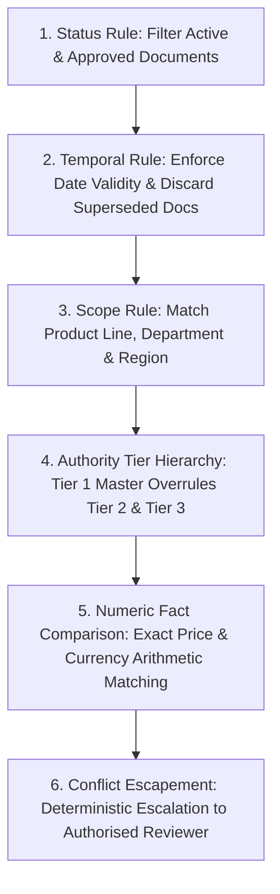
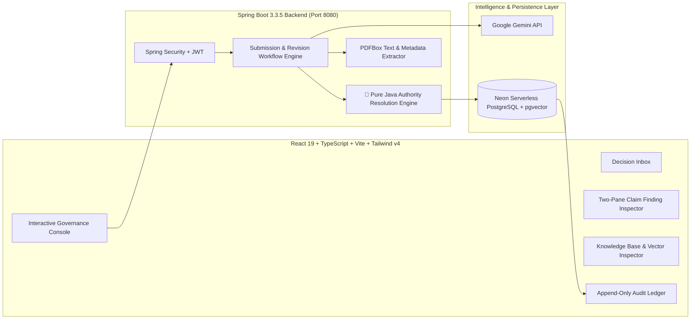

# ClaimLedger — AI-Powered Organisational Brand Governance

> **"Every claim, accounted for."**  
> Built for **CodeTitans India 2026** — *Problem Statement: Inkloom AI – Brand Governance*

[](https://www.oracle.com/java/)
[](https://spring.io/projects/spring-boot)
[](https://react.dev/)
[](https://tailwindcss.com/)
[](https://github.com/pgvector/pgvector)
[](https://ai.google.dev/)

---

### 🌐 Live Cloud Deployment
- **Live Application (Frontend on Vercel)**: [https://claimledger-india.vercel.app](https://claimledger-india.vercel.app)
- **Backend API (Render Cloud)**: [https://claimledger-backend.onrender.com](https://claimledger-backend.onrender.com)
- **Database (Neon Cloud)**: Serverless PostgreSQL with `pgvector` (`aws-ap-southeast-1`)
- **Interactive Swagger / OpenAPI Docs**: [https://claimledger-backend.onrender.com/swagger-ui.html](https://claimledger-backend.onrender.com/swagger-ui.html)

---

## 🎯 The Core Problem & Primary Differentiator

Organisational marketing and sales collateral are plagued by out-of-date pricing, unsupported performance claims, and non-compliant brand messaging. Generic LLM wrappers fail in enterprise brand governance because LLMs hallucinate, suffer from non-deterministic variance, and cannot enforce rigid institutional hierarchies.

### 💡 Why ClaimLedger Wins: Deterministic Authority Resolution

ClaimLedger couples modern RAG (Retrieval-Augmented Generation) with an institutional **6-Step Pure Java Authority Resolution Engine**. The LLM never decides compliance truth — pure deterministic code controls authority:



- **Tier 1 — Master Authority**: Single company-wide truth (e.g. `Product_Master_Catalogue_v4.2.pdf` at ₹999/mo).
- **Tier 2 — Departmental Scope**: Scoped proposals (e.g. `Nexora_Sales_Proposal_v2.pdf` at ₹899/mo).
- **Tier 3 — Supporting Material**: Legacy brochures and drafts (e.g. `Nexora_Old_Brochure_v1.pdf` at ₹799/mo).

When a creator submits content stating ₹799/mo, ClaimLedger does not guess: it deterministically overrides Tier 2 and Tier 3 sources using Tier 1 Master Authority and marks the claim as an actionable **VIOLATION** with exact character span highlights and one-click fixes.

---

## 🏛️ System Architecture



---

## 🔄 End-to-End Governance Workflow

1. **Knowledge Onboarding (Admin)**: Upload authoritative brand PDFs (`Product Master Catalogues`, `Brand Guidelines`). The backend extracts text with PDFBox, computes 768-dimensional embeddings, and indexes chunks in Neon `pgvector` with IVFFlat indexing.
2. **Content Submission (Creator)**: Creator submits campaign copy or PDFs with title and department.
3. **Claim Extraction & Vector Retrieval**: System isolates factual assertions (pricing, performance metrics, slogans) and executes cosine distance similarity search (`<=>`) against active knowledge chunks.
4. **Deterministic Authority Resolution**: The pure Java engine evaluates document tiers, validity dates, product scopes, and numeric facts to assign verdicts: `VERIFIED`, `VIOLATION`, `UNVERIFIED`, or `CONFLICT`.
5. **Interactive Reviewer Console (Reviewer)**: Reviewers view a two-pane layout with highlighted character spans (`[start, end]`), source evidence cards, and tier badges.
6. **Revision & Audit Trail**:
   - Creator can 1-click apply suggested corrections (e.g., auto-updating ₹799 to ₹999) and resubmit (bumping `revisionNumber`).
   - Reviewer approves, rejects, or requests changes.
   - Every action is written to an immutable append-only audit ledger (`review_actions`).

---

## 👥 Demo Scenario: Nexora Technologies

All demo accounts use password: `Demo@1234`

| Account | Email | Role | Responsibilities |
|---|---|---|---|
| **Priya Menon** | `creator@nexora.com` | `CREATOR` | Submits marketing copy, views findings, applies suggested fixes |
| **Sneha Krishnan** | `reviewer@nexora.com` | `REVIEWER` | Reviews flagged claims, inspects evidence tiers, issues formal approvals |
| **Rahul Verma** | `manager@nexora.com` | `DEPT_MANAGER` | Oversees departmental compliance and review queue |
| **Arjun Sharma** | `admin@nexora.com` | `ADMIN` | Manages authoritative knowledge docs, uploads catalogues, views audit trail |

---

## 💻 Tech Stack

- **Frontend**:
  - React 19 + TypeScript
  - Vite 8 (Hot Module Replacement)
  - Tailwind CSS v4 (`@tailwindcss/vite`)
  - TanStack Query (React Query)
  - React Router v7
  - Lucide React Icons
- **Backend**:
  - Java 17 + Spring Boot 3.3.5
  - Spring Data JPA + Hibernate 6
  - Spring Security with Stateless JWT Authentication
  - Apache PDFBox for PDF parsing
  - Jackson for clean envelope JSON serialization
- **Database & AI**:
  - Neon Serverless PostgreSQL (`ep-nameless-scene-aogybz86`)
  - `pgvector` extension with 768-dimensional vector cosine distance search
  - Google Gemini API (`gemini-3.8-flash` & `gemini-embedding-001`) with deterministic pure Java fallback

---

## ⚡ Quickstart Guide

### Prerequisites
- Java 17+
- Node.js 18+
- Maven

### 1. Clone Repository
```bash
git clone https://github.com/Ravikiranswamy/ClaimLedger.git
cd ClaimLedger
```

### 2. Run Backend
```bash
cd backend
# Set your Gemini API key (optional, deterministic fallback is active)
export GEMINI_API_KEY="your-api-key"
mvn clean package -DskipTests
java -jar target/claimledger-backend-1.0.0.jar
```
*Backend runs on `http://localhost:8080`.*

### 3. Run Frontend
```bash
cd frontend
npm install
npm run dev
```
*Frontend runs on `http://localhost:5173`.*

---

## 📊 Key API Endpoints

| Method | Endpoint | Description |
|---|---|---|
| `POST` | `/api/auth/login` | Authenticate user and issue JWT |
| `GET` | `/api/auth/me` | Fetch authenticated user profile and permissions |
| `POST` | `/api/submissions` | Submit text or PDF content for brand verification |
| `GET` | `/api/submissions` | List submissions filtered by role and department |
| `GET` | `/api/submissions/{id}` | Full submission details with claims and evidence |
| `GET` | `/api/submissions/{id}/findings` | Interactive character span offsets for UI highlighting |
| `PUT` | `/api/submissions/{id}/revise` | Creator resubmission with updated text |
| `POST` | `/api/submissions/{id}/review` | Reviewer decision: `APPROVE`, `REQUEST_CHANGES`, `REJECT` |
| `GET` | `/api/submissions/{id}/audit` | Full chronological audit trail for a submission |
| `GET` | `/api/submissions/audit` | Global governance audit ledger |
| `GET` | `/api/documents` | List knowledge documents and authority tiers |
| `GET` | `/api/documents/{id}/chunks` | Inspect pgvector text chunks and embeddings |
| `POST` | `/api/documents/upload` | Upload and chunk new authoritative PDF |

---

## 🏆 Hackathon Submission Details

- **Hackathon**: CodeTitans India 2026
- **Problem Statement**: Inkloom AI – Brand Governance
- **Repository**: [https://github.com/Ravikiranswamy/ClaimLedger](https://github.com/Ravikiranswamy/ClaimLedger)
- **Author**: Ravikiran Swamy (`ravikiranswamy550@gmail.com`)

